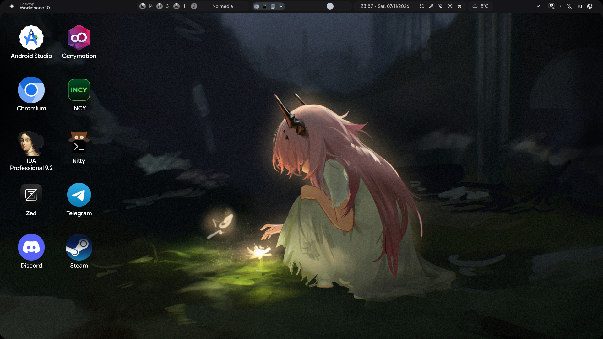
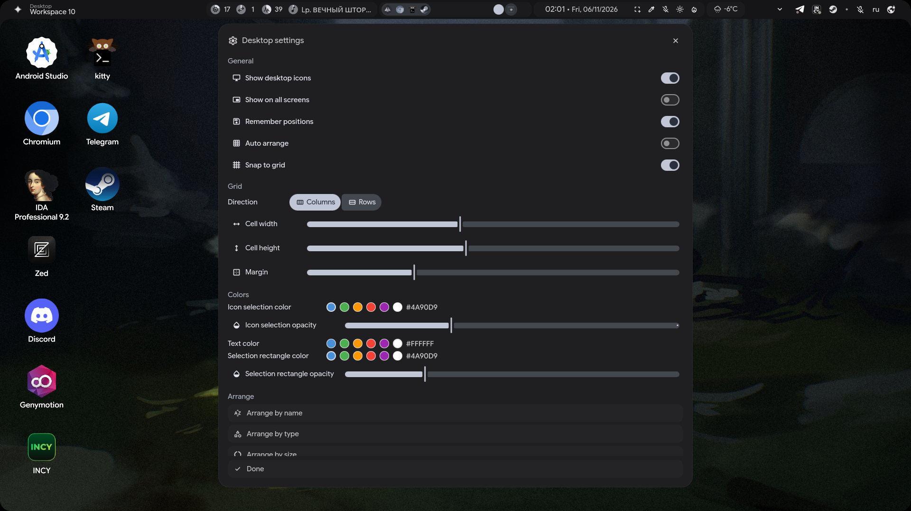

# illogical-desktop

A Windows-like active desktop for **illogical-impulse** (quickshell `ii`) on Hyprland:
icons for `~/Desktop`, selection, drag & drop, context menus, file operations and
desktop-entry aware icons/launching.



## Features

- Icons for everything in `~/Desktop`, laid out on a grid (columns or rows).
- Single click selects, double click opens with the system default application.
- Selection:
  - rubber-band selection (blue rectangle, color/opacity configurable);
  - `Ctrl+Click` (or `Ctrl+RightClick`) toggles an icon;
  - `Ctrl+A` selects all, `Esc` clears;
  - group drag moves the whole selection;
  - group actions: `Delete`, `Ctrl+C`, `Ctrl+X`, `Ctrl+V`, context menu.
- Drag an icon onto a folder to move it there (with groups).
- `Snap to grid`: dropped icons align to cells and swap with the occupant instead of
  overlapping.
- `Ctrl+wheel` zooms the grid; snapped positions are re-aligned to the new cell size,
  with overlaps resolved to free cells. Changing cell size or margin in the settings
  modal behaves the same way.
- Context menu on icons: Open, Open with, Rename, Copy, Cut, Move to Trash.
- Context menu on the desktop: New Folder, New File, Paste, Select all, Arrange icons,
  Refresh, Desktop settings, Open terminal.
- Arrange: by name, by type, by size, by date modified; auto arrange; grid direction;
  snap to grid; reset positions.
- Clipboard: `Ctrl+C` / `Ctrl+X` / `Ctrl+V` (copies get `name (copy).ext`).
- `Delete` moves the selection to trash, `F2` renames, `F5` refreshes.
- `.desktop` entries show their real `Name=` and `Icon=` and are launched with
  `gio launch` (so `Exec`, `Terminal`, placeholders work).
- Regular files use the icon of their default application for that MIME type
  (e.g. `.txt` shows the text editor icon, `.zip` the archive manager icon).
- "Open" resolves the default app for the MIME type explicitly, so files without an
  association (e.g. empty files) do not fall back to the browser via `$BROWSER`.

## Desktop settings

Right-click the desktop → **Desktop settings**. Everything applies live:

- **General**: show icons, show on all screens, remember positions, auto arrange,
  snap to grid.
- **Grid**: direction (columns/rows), cell width, cell height, margin.
- **Colors**: icon selection color and opacity, text color, selection rectangle
  (rubber band) color and opacity. Each color has presets and a HEX field. The
  rectangle color follows the icon selection color until it is customized separately.
- **Arrange**: by name/type/size/date, reset positions.
- **Done** closes the modal (it also closes from the `×` button or `Esc`; clicking the
  desktop does not dismiss it).



## Requirements

- illogical-impulse (quickshell `ii`) on Hyprland, tested with Quickshell 0.3.2.
- `gio` (glib2), `file`, `xdg-utils` (`xdg-mime`).
- `Qt.labs.folderlistmodel` (ships with Qt 6 declarative).

## Install

```bash
git clone https://github.com/0xcds4r/illogical-desktop.git
cd illogical-desktop
./install.sh
pkill -x qs; setsid -f qs -c ii
```

`install.sh` copies the new files and applies three small patches to
`Background.qml`, `Config.qml` and `Persistent.qml`. Pass a path as the first
argument for a non-default config location.

Manual install:

1. Copy `files/modules/ii/background/desktop/` into
   `~/.config/quickshell/ii/modules/ii/background/desktop/`.
2. Copy `files/scripts/desktop-*.sh` into `~/.config/quickshell/ii/scripts/` and
   `chmod +x` them.
3. Apply `patches/*.patch` with `patch -p1` from the ii config directory.

## Configuration

Settings live in `~/.config/illogical-impulse/config.json`:

```json
"background": {
  "desktopIcons": {
    "enable": true,
    "showOnAllScreens": false,
    "persistPositions": true,
    "autoArrange": false,
    "snapToGrid": false,
    "gridMode": "columns",
    "cellWidth": 96,
    "cellHeight": 104,
    "margin": 24,
    "selectionColor": "#4A90D9",
    "selectionOpacity": 0.35,
    "textColor": "#FFFFFF",
    "bandColor": "#4A90D9",
    "bandOpacity": 0.18
  }
}
```

- `gridMode`: `"columns"` (top to bottom, then next column) or `"rows"`.
- `snapToGrid`: align positions to cells; dropping onto an occupied cell swaps icons.
- `autoArrange`: always use the automatic grid (drops do not persist).
- `selectionColor` / `selectionOpacity`: icon selection highlight.
- `textColor`: icon labels.
- `bandColor` / `bandOpacity`: rubber-band selection rectangle.
- Icon positions are stored in `~/.local/state/quickshell/states.json` under
  `desktop.iconPositions`.

## Repository layout

```
files/modules/ii/background/desktop/   new QML module (icons, menus, settings, cache)
files/scripts/                         helper scripts (open, open-with, file icons)
patches/                               changes to existing ii files
install.sh                             installer
```

## Limitations

- Clipboard is internal to the shell; dragging files in from a file manager or out to
  another app is not implemented (Wayland layer-shell data devices).
- Rubber-band selection works on the desktop surface only.
- The rename editor uses a fullscreen overlay layer (needed for keyboard focus).

## Uninstall

Remove `modules/ii/background/desktop/` and `scripts/desktop-*.sh`, then revert the
patches:

```bash
for p in patches/*.patch; do patch -R -p1 -d ~/.config/quickshell/ii < "$p"; done
```

## License

MIT, see [LICENSE](LICENSE).
