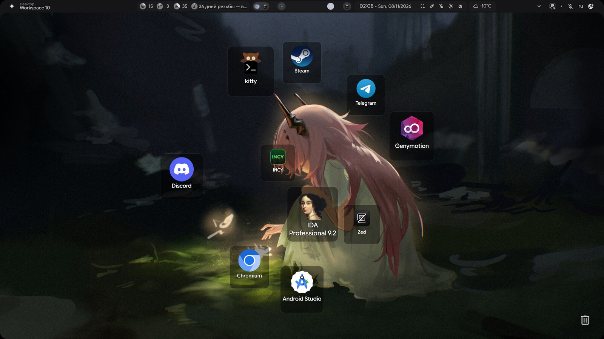
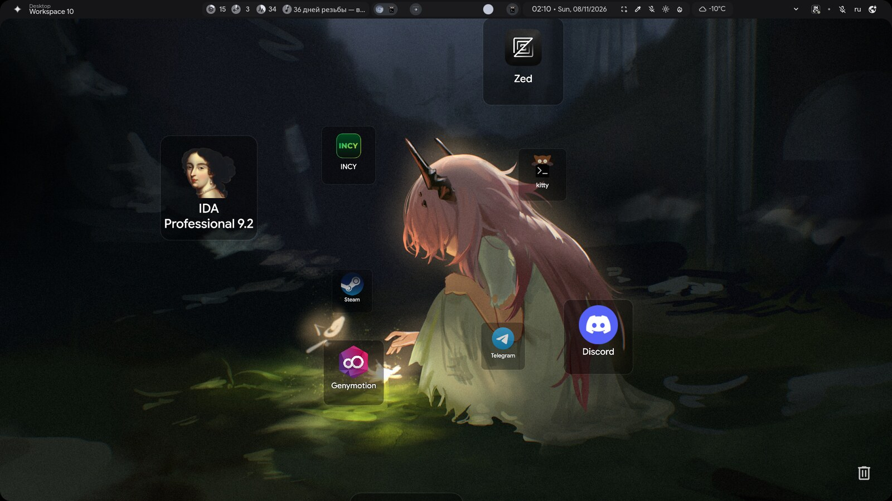
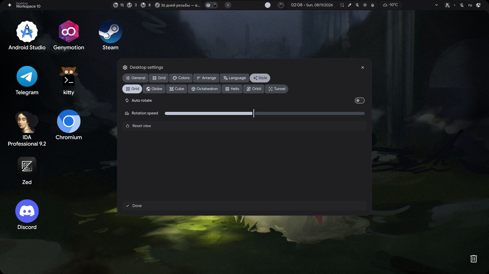
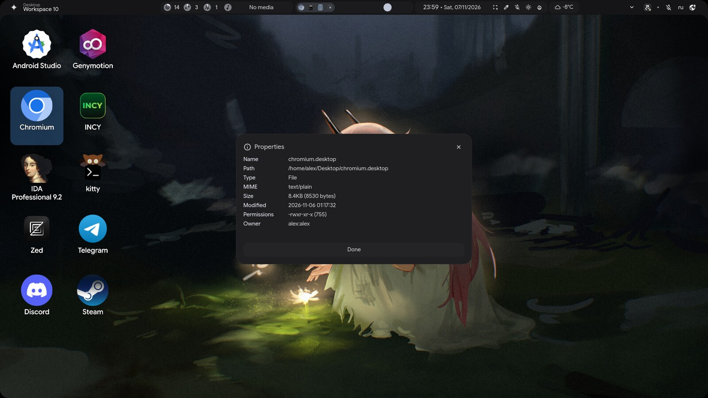
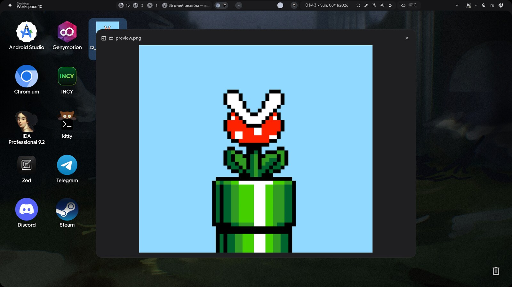

# illogical-desktop

A Windows-like active desktop for **illogical-impulse** (quickshell `ii`) on Hyprland:
icons for `~/Desktop`, selection, drag & drop, context menus, file operations and
desktop-entry aware icons/launching.

<p align="center"></p>

## Features

- Icons for everything in `~/Desktop`, laid out on a grid (columns or rows).
- Single click selects, double click opens with the system default application.
- Selection:
  - rubber-band selection (blue rectangle, color/opacity configurable);
  - `Ctrl+Click` / `Ctrl+RightClick` toggles, `Shift+Click` selects a range;
  - arrow keys move the selection, `Home`/`End`, `Enter` opens, `Space` previews;
  - `Ctrl+A` selects all, `Esc` clears;
  - group drag moves the whole selection;
  - group actions: `Delete`, `Ctrl+C`, `Ctrl+X`, `Ctrl+V`, context menu.
- `Ctrl+Z` undoes the last delete (restores from trash), rename or move.
- Drag an icon onto a folder to move it there (with groups); `Ctrl+drag` copies instead.
- `Snap to grid`: dropped icons align to cells and swap with the occupant instead of
  overlapping.
- `Ctrl+wheel` zooms the grid; snapped positions are re-aligned to the new cell size,
  with overlaps resolved to free cells. Changing cell size or margin in the settings
  modal behaves the same way.
- Context menu on icons: Open, Open with, Rename, Copy, Cut, Create link, Compress,
  Move to Trash, Properties.
- Context menu on the desktop: New Folder, New File, Paste, Select all, Arrange icons,
  Refresh, Desktop settings, Open terminal.
- Menus size themselves to the longest label, so longer translations are never cut off.
- Arrange: by name, by type, by size, by date modified; auto arrange; grid direction;
  snap to grid; reset positions.
- 3D desktop styles: **Globe, Cube, Octahedron, Helix, Orbit, Tunnel** (plus the normal
  Grid). Icons sit on translucent tiles, scale and fade with depth, and the shape can be
  rotated by dragging the desktop. Optional auto-rotation with adjustable speed and a
  "Reset view" action.
- Clipboard: `Ctrl+C` / `Ctrl+X` / `Ctrl+V` (copies get `name (copy).ext`).
- **Create link** makes a symlink (`name (link).ext`); **Compress** offers ZIP
  (fast/normal/max) and tar.gz; **Properties** shows type, MIME, size, dates,
  permissions and owner.
- **Empty Trash** shortcut with a live item count in the bottom-right corner
  (can be hidden in settings). Right-click it to open or empty the trash.
- **Quick look** (`Space`): images, text files, and thumbnails for video/PDF.
- File badges: symlink, executable and read-only markers on the icon.
- **Video and PDF thumbnails** (needs `ffmpeg` / `pdftoppm`).
- Icon metadata is cached, so refreshing the desktop does not re-run MIME lookups.
- `Delete` moves the selection to trash (optional confirmation), `F2` renames
  (the extension is preserved), `F5` refreshes.
- `.desktop` entries show their real `Name=` and `Icon=` and are launched with
  `gio launch` (so `Exec`, `Terminal`, placeholders work).
- Regular files use the icon of their default application for that MIME type
  (e.g. `.txt` shows the text editor icon, `.zip` the archive manager icon).
- "Open" resolves the default app for the MIME type explicitly, so files without an
  association (e.g. empty files) do not fall back to the browser via `$BROWSER`.

## Keyboard shortcuts

| Action | Shortcut |
|---|---|
| Open selected icon | double click |
| Toggle icon in selection | `Ctrl+Click` / `Ctrl+RightClick` |
| Select all | `Ctrl+A` |
| Clear selection | `Esc` |
| Move selection | arrow keys / `Home` / `End` |
| Open selected | `Enter` |
| Quick look | `Space` |
| Select range | `Shift+Click` |
| Undo last delete/rename/move | `Ctrl+Z` |
| Delete selection to trash | `Delete` |
| Rename | `F2` |
| Refresh (with pop-in wave) | `F5` |
| Copy / cut / paste | `Ctrl+C` / `Ctrl+X` / `Ctrl+V` |
| Zoom grid | `Ctrl+wheel` |

## Desktop settings

Right-click the desktop → **Desktop settings**. Everything applies live, split into tabs:

- **General**: show icons, show on all screens (multi-monitor), show icon labels,
  remember positions, auto arrange, snap to grid.
- **Grid**: direction (columns/rows), cell width, cell height, margin.
- **Colors**: icon selection color and opacity, text color, selection rectangle
  (rubber band) color and opacity. Each colour has a live swatch, a HEX field, a full
  HSV picker (saturation/value square + hue strip) with RGB/HSV readout, and a palette
  of 32 presets. The rectangle color follows the icon selection color until it is
  customized separately.
- **Arrange**: by name/type/size/date, reset positions.
- **Style**: Grid / Globe / Cube / Octahedron / Helix / Orbit / Tunnel, auto-rotate,
  rotation speed and reset view.
- **Language**: switches the add-on's language only (English, Russian, Ukrainian,
  Belarusian, Polish, German, French, Spanish, Japanese, Chinese, Korean). The rest of
  the shell keeps its own language.
- **Done** closes the modal (it also closes from the `×` button or `Esc`; clicking the
  desktop does not dismiss it).

<p align="center"></p>

Colors tab with the HSV picker:

<p align="center"></p>

Language tab:

<p align="center"></p>

## Desktop styles

Settings → **Style** switches the icon layout between the normal grid and 3D shapes.
Drag the desktop to rotate/tilt the shape; enable **Auto rotate** to spin it, adjust the
speed, or use **Reset view**.

<p align="center"></p>

<p align="center"></p>

<p align="center"></p>

## Context menus

| Icon actions | Desktop actions |
|---|---|
|  |  |

## File actions

Properties dialog for any icon:

<p align="center"></p>

## Quick look

Press `Space` on a file to preview it (images, text, video/PDF thumbnails):

<p align="center"></p>

## Requirements

- illogical-impulse (quickshell `ii`) on Hyprland, tested with Quickshell 0.3.2.
- `gio` (glib2), `file`, `xdg-utils` (`xdg-mime`).
- `zip` for the Compress action, `tar` for tar.gz.
- `python3` (trash helper).
- `ffmpeg` (video thumbnails) and `pdftoppm` from poppler (PDF thumbnails) — optional.
- `Qt.labs.folderlistmodel` (ships with Qt 6 declarative).

## Install

```bash
git clone https://github.com/0xcds4r/illogical-desktop.git
cd illogical-desktop
./install.sh
pkill -x qs; setsid -f qs -c ii
```

`install.sh` copies the module and scripts, writes the add-on's own settings/state
files (migrating values from older installs), and injects a single `Loader` into
`Background.qml` using structural anchors. It is idempotent: running it again does
nothing. Pass a path as the first argument for a non-default config location.

Manual install:

1. Copy `files/modules/ii/background/desktop/` into
   `~/.config/quickshell/ii/modules/ii/background/desktop/`.
2. Copy `files/scripts/desktop-*.sh` into `~/.config/quickshell/ii/scripts/` and
   `chmod +x` them.
3. Add `import qs.modules.ii.background.desktop` to `Background.qml` and insert the
   `Loader` block from `install.sh` before `WidgetCanvas`.

## Configuration

The add-on keeps its settings in its own file,
`~/.config/illogical-impulse/desktop-icons.json` (not in the shell's `config.json`):

```json
{
    "enable": true,
    "showOnAllScreens": false,
    "showLabels": true,
    "persistPositions": true,
    "autoArrange": false,
    "snapToGrid": false,
    "gridMode": "columns",
    "cellWidth": 96,
    "cellHeight": 104,
    "margin": 24,
    "selectionColor": "#4A90D9",
    "selectionOpacity": 0.35,
    "textColor": "#FFFFFF",
    "bandColor": "#4A90D9",
    "bandOpacity": 0.18,
    "language": "en",
    "folder": "",
    "confirmDelete": false,
    "showTrash": true,
    "styleMode": "grid",
    "styleAutoRotate": false,
    "styleSpeed": 1.0
}
```

- `showOnAllScreens`: load the desktop on every monitor. With a single monitor it has
  no visible effect (icons always show there); with several, each screen gets its own
  grid and its own saved positions.
- `gridMode`: `"columns"` (top to bottom, then next column) or `"rows"`.
- `snapToGrid`: align positions to cells; dropping onto an occupied cell swaps icons.
- `autoArrange`: always use the automatic grid (drops do not persist).
- `showLabels`: show the filename under each icon; when off, icons are centered in the cell.
- `selectionColor` / `selectionOpacity`: icon selection highlight.
- `textColor`: icon labels.
- `bandColor` / `bandOpacity`: rubber-band selection rectangle.
- `language`: language of the add-on UI only (`en`, `ru`, `uk`, `be`, `pl`, `de`, `fr`,
  `es`, `ja`, `zh`, `ko`). The shell language is not changed.
- `folder`: custom folder to show instead of `~/Desktop` (empty means `~/Desktop`).
- `confirmDelete`: ask before moving the selection to trash.
- `showTrash`: show the trash shortcut in the bottom-right corner.
- `styleMode`: `grid`, `globe`, `cube`, `octahedron`, `helix`, `orbit` or `tunnel`.
- `styleAutoRotate` / `styleSpeed`: automatic rotation for the 3D styles.
- Icon positions are stored in `~/.local/state/quickshell/user/desktop-positions.json`.
- Older installs migrated automatically from `config.json` / `states.json` on first run.

## Repository layout

```
files/modules/ii/background/desktop/
  DesktopIcons.qml        grid, selection, drag & drop, menus, actions
  DesktopIcon.qml         icon delegate (labels, .desktop icons, file icons)
  DesktopContextMenu.qml  context menu renderer
  DesktopFileOps.qml      file operations (copy, trash, link, compress, ...)
  DesktopSettings.qml     settings modal
  DesktopProperties.qml   properties modal
  DesktopIconCache.qml    metadata cache for smooth refreshes
  DesktopConfig.qml       own settings file
  DesktopPositions.qml    own icon-position state file
files/scripts/
  desktop-open.sh         open with the default application
  desktop-open-with.sh    list applications for a file type
  desktop-file-icon.sh    icon from the default application
  desktop-file-props.sh   properties for the Properties dialog
install.sh                installer (idempotent injection)
uninstall.sh              removes the module and the injected loader
```

## Compatibility with shell updates

The add-on does not modify `Config.qml` or `Persistent.qml`; settings and positions
live in its own files. The only hook is one `Loader` inserted into `Background.qml`
before `WidgetCanvas` (plus a keyboard-focus line and an import), so a shell update
usually cannot break the install: re-running `install.sh` re-copies the module and,
if upstream changed the file, injects the loader again.

It is not an absolute guarantee: if upstream renames/restructures `Background.qml` so
that the `WidgetCanvas` anchor no longer exists, the installer stops with a clear
error instead of corrupting the file. In that case the `Loader` block needs a new
anchor.

## Limitations

- Clipboard is internal to the shell; dragging files in from a file manager or out to
  another app is not implemented (Wayland layer-shell data devices).
- Rubber-band selection works on the desktop surface only.
- With `showOnAllScreens` off, secondary monitors have no desktop context menu or
  settings modal (the module is not loaded there).
- The rename editor and both modals use fullscreen overlay layers (needed for keyboard
  focus).
- Compress follows symlinks: the archive stores the link target's contents.

## Uninstall

```bash
./uninstall.sh
pkill -x qs; setsid -f qs -c ii
```

This removes the module, scripts and the injected loader; settings and positions are
kept (delete `~/.config/illogical-impulse/desktop-icons.json` and
`~/.local/state/quickshell/user/desktop-positions.json` to reset them).

## License

MIT, see [LICENSE](LICENSE).
